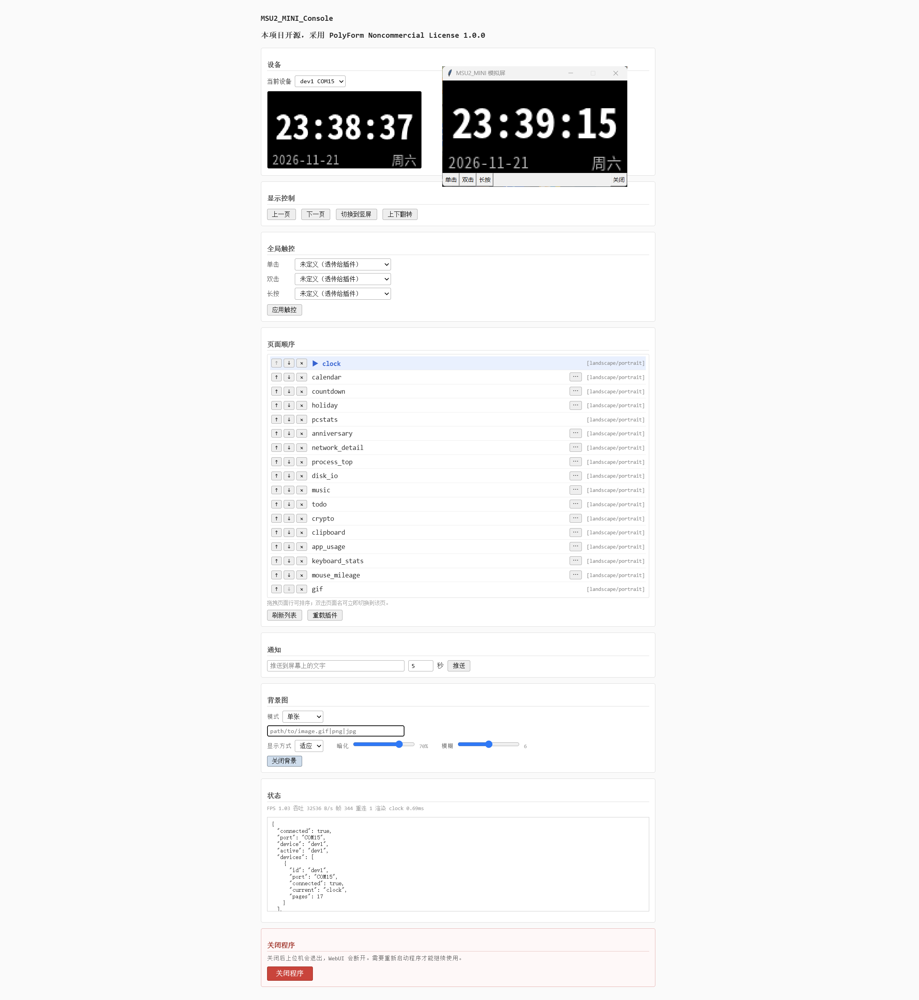

# MSU2_MINI_Console

> **MSU2_MINI 可编程 USB 屏幕的跨平台上位机**

一个插件化的上位机控制台，使用 WebUI 调整小屏显示的内容、顺序和朝向，支持 Windows / Linux

> **关于代码质量**：本项目作者并非专业 Python 开发者，代码可能不够优雅，欢迎接手。

<p>
  
  
  
</p>

---



## 目录

- [内置插件](#内置插件)
- [安装](#安装)
- [快速开始](#快速开始)
- [Web 控制台](#web-控制台)
- [多设备](#多设备)
- [硬件触控按键](#硬件触控按键)
- [命令行参数](#命令行参数)
- [打包成二进制文件](#打包成二进制文件)
- [外挂插件](#外挂插件)
- [插件开发](#插件开发)
- [项目结构](#项目结构)
- [常见问题](#常见问题)
- [致谢](#致谢)

---

## 内置插件

17 个 demo

| 插件 ID | 名称 | 功能 | 朝向 | 触控支持 |
|---|---|---|---|---|
| `clock` | 时钟 | 时间 + 年月日 + 星期 | 横 / 竖 | — |
| `calendar` | 月历 | 月历 / 周历，今日高亮 | 横 / 竖 | — |
| `countdown` | 倒计时 | 多事件倒计时，按紧迫度着色 | 横 / 竖 | ✔ |
| `anniversary` | 纪念日 | 任意多个纪念日，横屏一屏一个（名称在上、天数在下） | 横 / 竖 | ✔ |
| `holiday` | 节假日 | 距下个节假日的天数 | 横 / 竖 | ✔ |
| `pcstats` | 系统状态 | CPU / RAM / 磁盘 / 网络 / 开机时长 | 横 / 竖 | — |
| `disk_io` | 磁盘读写 | 读写速率 + 折线图 | 横 / 竖 | — |
| `network_detail` | 网络详情 | 网卡速率 + Wi-Fi 信号 | 横 / 竖 | — |
| `process_top` | 进程排行 | Top 6 进程，可按 CPU / 内存排序，名称过长自动滚动 | 横 / 竖 | — |
| `app_usage` | 前台应用 | 当前应用 + 使用时长（启动即统计） | 横 / 竖 | ✔ |
| `keyboard_stats` | 键盘统计 | 今日敲击次数 + KPM（可清零） | 横 / 竖 | ✔ |
| `mouse_mileage` | 鼠标里程 | 今日移动距离（可清零） | 横 / 竖 | ✔ |
| `music` | 音乐 | 音乐信息 + 旋转光盘 | 横 / 竖 | ✔ |
| `crypto` | 加密货币 | 实时价 + 涨跌幅，可配刷新周期 | 横 / 竖 | ✔ |
| `clipboard` | 剪贴板 | 剪贴板历史，可固定当前条 | 横 / 竖 | ✔ |
| `todo` | 待办 | 读 `todo.md`，Web 端可编辑，支持勾选/翻页 | 横 / 竖 | ✔ |
| `gif` | 背景透传 | 只显示背景图，不带任何设置与动作 | 横 / 竖 | — |

「触控支持」一栏表示该插件实现了 `on_action("touch_*")`，在透传模式下响应小屏按键。

> 没做投屏插件，也不打算做投屏插件，没有什么实际用途

---

## 安装

### 环境要求

- Python 3.8 或更高
- 一块 MSU2_MINI（或兼容的同款硬件）

### 步骤

```bash
# 1. 拷贝整个项目到本地
cd MSU2_MINI_Console

# 2. 装必装依赖
pip install pyserial pillow psutil pynput
```

### 可选依赖

用到对应插件时才需要装：

```bash
# Linux 上的剪贴板插件
sudo apt install xclip              # X11
sudo apt install wl-clipboard       # Wayland

# Linux 上的音乐控制
sudo apt install playerctl

# Linux 上的音乐信息读取
pip install dbus-python
```

### Linux 额外说明

如果扫描设备出现 PermissionError ，说明当前用户权限不足，无法访问串口。解决方案如下：

检查用户是否在 `dialout` 组：

```bash
groups $USER | grep dialout
# 如果没有：
sudo usermod -a -G dialout $USER
# 注销重新登录后生效
```

除非你用的是无头服务器，否则非常不建议直接用root账户

---

## 快速开始

```bash
python msu2_mini.py
```

程序会自动：

1. 扫描所有串口，找到 MSU2_MINI
2. 在项目目录生成 `config.json`
3. 加载所有插件，并生成插件独有的文件(如有)
4. 启动 WebUI，监听所有网卡的8765端口，即 `http://0.0.0.0:8765`

本机打开浏览器访问 `http://127.0.0.1:8765` 就能看到控制台。

**如果没找到设备**：

- 检查串口是否被其它串口程序占用
- 拔插一次 USB 后重跑
- 用 `python msu2_mini.py --list` 看有没有识别到串口

---

## Web 控制台

浏览器打开 WebUI 后分为这些块：

### 设备

- 顶部下拉列出配置里的所有设备（`dev1`、`dev2`……），显示串口、连接状态和当前插件
- 切换后，下面的显示控制、页面顺序、背景、触控、状态全部作用于**选中那台**屏幕
- 每台设备独立保存自己的页面列表、朝向、翻转和背景，互不影响

### 显示控制

| 按钮 | 作用 |
|---|---|
| `上一页` / `下一页` | 切换小屏当前显示的插件 |
| `切换朝向` | 横屏 ↔ 竖屏 |
| `上下翻转` | 屏幕图像 180° 翻转 |

> 每个操作有 0.8 秒冷却，防止连点导致花屏。

### 全局触控

小屏上的触摸按键可以绑三种手势——**单击 / 双击 / 长按**——各自对应一个动作。

**两种运行模式**：

1. **透传模式**：三个手势都选 `未定义（透传给插件）`。手势事件交给当前插件处理。此时：
   
| 示例插件 | 单击 | 双击 | 长按 |
|---|---|---|---|
| music | 下一首 | 上一首 | 播放 / 暂停 |
| todo | 选中下一条 | 选中上一条 | 勾选 / 取消 |
| clipboard | — | — | 固定 / 取消固定 |
| countdown、holiday、crypto | 下一个 | 上一个 | — |

每个插件的具体手势含义写在该插件的配置面板里（打开 `⋯` → `设置` 就能看到"透传触控"一行）。
   
   > 需要 `playerctl`（Linux）/ pynput（宏）等外部工具支持的，见[安装](#安装)。
2. **全局模式**：某个手势选了具体动作，只有那个手势走全局定义；选了 未定义（透传给插件） 的手势仍然交给插件处理。

**可选动作**：

| 动作 | 说明 |
|---|---|
| `未定义（透传给插件）` | 交给当前插件（默认值） |
| `下一页` / `上一页` | 切页 |
| `上下翻转` | 屏幕 180° 翻转 |
| `横竖屏切换` | 横屏 ↔ 竖屏 |
| `锁定/解锁当前页` | 锁定时忽略触摸翻页，Web 按钮不受影响 |
| `截屏` | 保存到 `./screenshots/shot_YYYYMMDD_HHMMSS.png` |
| `静音 / 解除` | 系统静音切换 |
| `自定义键盘宏` | 发送组合键，如 `ctrl+shift+s`、`alt+f4`、`win+r` |
| `自定义程序` | 启动一个程序或命令，例：`notepad`、`C:\Windows\notepad.exe`、`firefox`、`/usr/bin/code` |
| `关闭程序` | 退出上位机 |

**宏语法**：用 `+` 连接修饰键和主键，大小写不敏感。修饰键 `ctrl` / `shift` / `alt` / `win` / `cmd`，主键支持单字符、`enter` / `esc` / `tab` / `space` / `backspace` / `delete` / `up` / `down` / `left` / `right` / `home` / `end` / `pageup` / `pagedown` / `f1`~`f12`。

### 页面顺序

- 每一行是一个插件
- “设备”卡片里有一张实时预览图（`/api/preview?name=` 现画），显示当前屏幕上的插件
- `↑↓` 调整顺序，`×` 停用
- 蓝色高亮 + ▶ 标记的是当前屏幕正在显示的插件
- 每行右侧是 `⋯` 按钮（在 `[landscape/portrait]` 左边），点开是弹出菜单：`设置` 加该插件自定义的动作，没有配置也没有动作的插件不显示这个按钮
- 弹出菜单不会自己关：再点一次 `⋯`、点另一个 `⋯`，或者点菜单里的项目才会关闭
- **拖拽**任意页面行可以调整顺序
- **双击**页面名称可以立即切换到该页

### 配置面板

点弹出菜单里的 `设置` 会展开配置表单，修改后点"保存"立即生效，同时写入 `config.json`。

### 背景图

- 填图片路径（支持 PNG / JPG / GIF）或图片目录，选好缩放方式后点"启用背景"
- 三种缩放方式：`适应` / `填充` / `拉伸`
- 插件绘制的透明区域会透出背景
- 支持动态 GIF 和图片序列目录（目录内按文件名顺序循环播放）
- 背景有两种模式：`单张` 和 `多张轮播`
- 轮播模式下框里一行一个路径（最多 32 个），可以设几秒轮一次（2–3600），也可以勾选“无序轮播”
- `暗化`（0–90）把背景压暗，`模糊`（0–12）加高斯模糊，方便前景文字看清

### 通知

填文字、设秒数，点“推送”会在屏幕上盖一张提示卡片，到时间自动消失。也可以 `POST /api/notify {"text": "...", "secs": 5}`。

### 状态

顶部一行是性能数据：FPS、吞吐（字节/秒）、累计帧数、重连次数、各插件渲染耗时最慢的几个。

下面是实时 JSON：连接状态、串口号、设备、当前插件、朝向、翻转、锁定、背景开关与缩放方式。

---

## 多设备

一个进程可以同时驱动多块屏幕（最多 8 块），配置里每台设备一个条目：

```json
{
  "devices": [
    {
      "id": "dev1",
      "port": "auto",
      "pages": ["clock", "pcstats", "todo"],
      "orientation": "landscape",
      "reverse": false,
      "background": {"enabled": false, "path": "", "paths": [], "mode": "fit", "dim": 0, "blur": 0},
      "touch": {"single": "passthrough", "double": "passthrough", "long": "passthrough"}
    },
    {
      "id": "dev2",
      "port": "COM7",
      "pages": ["music", "calendar"],
      "orientation": "portrait"
    }
  ],
  "gif_dir": "assets/gif",
  "widget_config": {},
  "web": {"host": "0.0.0.0", "port": 8765}
}
```

说明：

- `port` 写 `auto` 时自动扫描，已经分给别台设备的串口会被跳过
- 每台设备的页面、朝向、翻转、背景、触控各自独立；`widget_config` 是全局共享的
- WebUI 顶部“设备”下拉切换当前操作的是哪一块屏，其余接口都跟着走
- 旧版单设备配置（顶层 `port` / `pages` / `orientation`……）启动时会自动迁移成 `devices[0]`
- 加 `--simulate` 会额外开一块虚拟屏幕（标识 `sim`），物理屏照常运行；弹出的“模拟屏”窗口里有“单击 / 双击 / 长按”三个按钮，点击即派发到当前插件的手势处理
- 串口被拔掉只影响那一台，其它屏照常刷新；插回来会自己重连
- `--port` 只覆盖第一台设备的串口

---

## 硬件触控按键

MSU2_MINI 面板上有一个触摸按键，通过 ADC 通道 9 检测按下。

### 判定逻辑

| 手势 | 触发条件 |
|---|---|
| 单击 | 按下后松开，两次按下之间超过 350ms |
| 双击 | 两次短按之间小于 350ms |
| 长按 | 按住超过 800ms |

### 阈值标定

不同板子的触摸 ADC 基线不同，程序启动时会自动采集前 6 个样本作为基准值，日志里会打印：

```
[INFO] msu2: 触摸基准 = 1234
```

如果按键**完全没反应**或**一直误触发**，说明阈值不对。用 `--log DEBUG` 观察按下时日志里的 ADC 值：

```
[DEBUG] touch adc=1130 base=1234
```

把 `config.json` 里 `touch.threshold` 设为 `(基准 - 按下值) / 2` 左右。默认 60。

### 手动改配置

不方便用 Web 时，直接改 `config.json`：

```json
"touch": {
  "single": "passthrough",
  "double": "passthrough",
  "long":   "passthrough",
  "macro_single": "",
  "macro_double": "",
  "macro_long":   "",
  "program_single": "",
  "program_double": "",
  "program_long":   "",
  "threshold": 60
}
```

---

## 命令行参数

```bash
python msu2_mini.py [选项]
```

| 参数 | 说明 |
|---|---|
| `--list` | 列出所有串口 |
| `--plugins` | 列出所有已发现的插件 |
| `--init-config` | 删除旧配置，重新生成 `config.json` |
| `--headless` | 无头模式，不启动 WebUI |
| `--simulate` / `--offline` | 额外开一个 tkinter “模拟屏”窗口，不影响物理屏 |
| `--new-widget my_clock` | 在 `widgets_ext/` 生成一个外挂插件骨架 |
| `--log DEBUG` | 打印 DEBUG 级日志（也可用 `--log-level DEBUG`） |
| `--log-level DEBUG` | 日志级别：`DEBUG` / `INFO` / `WARNING` / `ERROR` |
| `--log-file run.log` | 日志同时写入文件 |
| `--config 2333.json` | 指定配置文件路径 |
| `--port /dev/ttyACM0` | 手动指定串口，跳过自动扫描 |

---

## 打包成二进制文件

如果你想在不含 Python 的机器上运行，打包成单文件即可。

### Windows

装好 `pyinstaller` 后直接双击 `build.bat`：

```bash
pip install pyinstaller
```

产物在 `dist/MSU2_MINI.exe`。

**注意**：

- 想看到控制台窗口输出日志，删掉 `build.bat` 里的 `--noconsole`
- 单文件版**支持外挂插件**，不需要为了加插件去删 `--onefile`，见下面的「外挂插件」一节

### Linux

```bash
pip install pyinstaller
chmod +x build.sh
./build.sh
```

产物在 `dist/MSU2_MINI`。

**注意**：同 Windows 的说明，`--onefile` 与 `--noconsole` 取舍相同。

### macOS

未测试。理论命令与 Linux 相同。

### 统一打包脚本

三个平台的构建参数写在 `tools/build_exe.py` 里，本地直接调：

```bash
python tools/build_exe.py --mode console            # 带控制台
python tools/build_exe.py --mode noconsole          # 无控制台（Windows 才有区别）
python tools/build_exe.py --name MyBuild --dist out # 自定义产物名与目录
```

脚本会自动带上 `msu2_core` / `widgets` / `assets` 三个数据目录、隐藏导入和图标，缺哪个可选依赖就自动排除哪一项（比如没装 numpy 就走纯 Python 编码器）。

### GitHub Actions

仓库自带 [`.github/workflows/build.yml`](.github/workflows/build.yml)，推 `v*` 标签或在 Actions 页面手动 `Run workflow` 就会构建 **8 个产物**：

| 产物 | 说明 |
|---|---|
| `MSU2_Console-windows-x64-console` | Windows 64 位，带控制台 |
| `MSU2_Console-windows-x64-noconsole` | Windows 64 位，无控制台 |
| `MSU2_Console-windows-x86-console` | Windows 32 位，带控制台 |
| `MSU2_Console-windows-x86-noconsole` | Windows 32 位，无控制台 |
| `MSU2_Console-windows-arm64-console` | Windows ARM64，带控制台 |
| `MSU2_Console-windows-arm64-noconsole` | Windows ARM64，无控制台 |
| `MSU2_Console-linux-x64` | Linux x86_64 |
| `MSU2_Console-linux-arm64` | Linux aarch64 |

每个产物都是单文件，从对应平台的 job 里直接下载 Actions artifact 即可。Linux 只有一个版本，因为 PyInstaller 在 Linux 上会忽略 `--noconsole`，两种模式产出同一个二进制。

Windows x86 用 32 位 Python 构建（`psutil` 钉在最后一版带 win32 轮子的 `7.1.1`），Windows ARM64 用 python.org 的 arm64 安装包，Linux 用各自的系统 Python 建 venv，不依赖预装版本。

---

## 外挂插件

单文件 exe 也能加第三方插件，**不用重新打包**。

在 exe 旁边建一个 `widgets` 文件夹，把 `.py` 丢进去即可：

```
MSU2_Console.exe
widgets/
├── hello_widget.py
└── my_plugin.py
```

重启程序，插件就会被自动发现并出现在 Web 的页面列表里。

### 搜索顺序

按下面的顺序找插件目录，**全部都会加载**（不是只加载第一个）：

1. 环境变量 `MSU2_WIDGETS_DIR` 指定的目录（多个用系统路径分隔符隔开，Windows 是 `;`）
2. exe 同级的 `widgets/`
3. `%LOCALAPPDATA%\MSU2_MINI\widgets\`（Linux/macOS 上是 `~/.local/share/MSU2_MINI/widgets/`）

源码方式运行（`python msu2_mini.py`）时，外挂目录是项目根目录下的 `widgets_ext/`，因为 `widgets/` 本身已经是内置插件包了。

### 目录里放什么

- `something.py` —— 一个文件就是一个插件模块
- `something/__init__.py` —— 也可以放整个包，包内可以多文件、相对导入
- 以 `_` 或 `.` 开头的文件和文件夹会被跳过

### 限制

外挂插件运行在主程序进程里，所以：

- **只能用程序已经打包进去的库**：标准库 + `Pillow` + `pyserial` + `psutil`，另加可选装好的 `numpy` / `pynput`
- 想用别的第三方库（`requests`、`psutil` 之外的系统库等），必须自己改成 `urllib` / `subprocess` 等标准库实现，或者自己重新打包
- 插件用绝对导入 `from msu2_core import ...`，**不要用相对导入**（`from .xxx`）
- 单个插件导入失败只会打一条 ERROR 日志，不影响其它插件

### 验证是否加载成功

```bash
MSU2_Console.exe --plugins
```

`SRC` 列会标出 `内置` / `外挂`：

```
NAME               ORI                    PRI   SRC    DESC
--------------------------------------------------------------------------------------
clock              landscape/portrait     10    内置
hello_external     landscape/portrait     200   外挂
```

启动日志里也会打印：

```
外部插件目录: C:\...\widgets
外部插件加载 1 个: hello_widget.py (C:\...\widgets)
```

### 示例

`example/widgets/hello_widget.py` 是一个可以直接用的外挂插件示例，
复制到 exe 旁边的 `widgets/` 里就能跑（含配置项、插件动作、触控手势）。

> 外挂插件和内置插件**同名**时会被后者覆盖（日志里会警告「插件 xxx 被重复注册」），
> 可以用这个办法替换某个内置插件的行为。

---

## 插件开发

**核心理念**：加插件 = 在 `widgets/` 里新建一个 `.py` 文件。主程序、`msu2_core`、其它插件都不用动。

### 最小示例

新建 `widgets/hello.py`：

```python
from PIL import Image, ImageDraw
from msu2_core import Widget, register, BOTH, get_font

@register
class HelloWidget(Widget):
    """第一行 docstring 会成为插件描述。"""
    name = "hello"              # 唯一 ID
    interval = 1.0              # 刷新间隔（秒）
    orientations = BOTH         # BOTH / (LANDSCAPE,) / (PORTRAIT,)
    priority = 100              # 排序权重，越小越靠前

    def render(self, ctx):
        W, H = ctx.size
        img = Image.new("RGBA", (W, H), (0, 0, 0, 0))
        d = ImageDraw.Draw(img)
        d.text((W // 2, H // 2), "Hello",
               fill="white", font=get_font(24), anchor="mm")
        return img
```

保存后重启程序，Web 页面上就会出现 `hello` 插件。

### 声明式配置

只要声明 `config_schema`，Web 上该行会出现 `⋯` 按钮，菜单里的 `设置` 会展开表单：

```python
from msu2_core import Field

class MyWidget(Widget):
    config_schema = [
        Field("name", "str", "名字", default="世界"),
        Field("count", "int", "次数", default=10, min=1, max=100),
        Field("mode", "select", "模式", default="A", options=["A", "B", "C"]),
        Field("items", "list_str", "列表", default=["a", "b", "c"],
              help="每行一个"),
    ]

    def render(self, ctx):
        cfg = self.get_config(ctx)
        name = cfg["name"]      # 用户填的值，未填则是 default
```

字段类型：`str` / `int` / `float` / `bool` / `select` / `list_str`

### 声明式按钮

```python
class PomodoroWidget(Widget):
    actions = {
        "start": "开始",
        "stop":  "停止",
    }

    def on_action(self, action, payload, ctx):
        if action == "start":
            ctx.state["running"] = True
            return {"ok": True}
        if action == "stop":
            ctx.state["running"] = False
            return {"ok": True}
        return {"ok": False, "err": f"未知动作 {action}"}
```

Web 页面会自动生成"开始"、"停止"两个按钮。

### 响应硬件触控

当「全局触控」三个手势都设为 `未定义（透传给插件）` 时，触摸事件会**透传给当前插件**，通过 `on_action` 收到下列动作名：

| action | 触发时机 |
|---|---|
| `touch_single` | 单击 |
| `touch_double` | 双击 |
| `touch_long` | 长按 |

最小示例：

```python
class MyWidget(Widget):
    def on_action(self, action, payload, ctx):
        if action == "touch_single":
            ctx.state["page"] = ctx.state.get("page", 0) + 1
            return {"ok": True}
        if action == "touch_double":
            ctx.state["page"] = ctx.state.get("page", 0) - 1
            return {"ok": True}
        if action == "touch_long":
            ctx.state["page"] = 0
            return {"ok": True}
        return {"ok": False, "err": f"未知动作 {action}"}
```

`return {"ok": True}` 会让主程序立刻触发重绘，不用等 `interval`。

参考实现：`music` / `todo` / `clipboard`。

### 渲染提示

- `ctx.size` 会随朝向变化，**不要硬编码** 160×80
- 返回 `RGBA` 图片，透明区域会透出背景
- **缓存机制**：内容未变化时返回 `None`，可大幅降低带宽占用：
  ```python
  def render(self, ctx):
      key = f"{int(ctx.now)}"     # 每秒变一次
      if ctx.state.get("_last_key") == key:
          return None
      ctx.state["_last_key"] = key
      # ... 绘制 ...
  ```
- **切页清缓存**：使用 `_last_key` 缓存的插件，切回来时必须清缓存：
  ```python
  def on_enter(self, ctx):
      ctx.state.pop("_last_key", None)
  ```

### Widget API 速览

| 方法 | 调用时机 | 用途 |
|---|---|---|
| `setup(ctx)` | 插件加载时 | 读文件、开线程、初始化状态 |
| `teardown(ctx)` | 插件卸载 / 退出时 | 关闭线程、释放资源 |
| `on_enter(ctx)` | 成为当前页时 | 清缓存，强制重绘 |
| `on_leave(ctx)` | 离开当前页时 | 暂停后台工作 |
| `render(ctx)` | 主循环按 `interval` 调 | 返回图像或 `None` |
| `get_config(ctx)` | 任意时刻 | 读自己那份配置 |
| `on_action(action, payload, ctx)` | Web 按钮 / 硬件触控 | 处理交互动作 |

`ctx` 字段：`size` / `orientation` / `now` / `state`（插件专属字典）/ `config` / `device`

---

## 项目结构

```
MSU2_MINI_Console/
├── msu2_mini.py              # 主程序
├── build.bat                 # Windows 打包脚本
├── build.sh                  # Linux 打包脚本
├── README.md
├── widgets-dev.md            # 插件开发手册
├── assets/
│   └── fonts/                # 内置字体（Noto Sans Mono CJK SC）
├── example/
│   └── widgets/              # 外挂插件示例
├── msu2_core/ 
│   ├── __init__.py           # 对外 API
│   ├── widget.py             # Widget 基类 + 渲染上下文 + 字体
│   ├── registry.py           # 插件注册表
│   └── config_schema.py      # 配置字段类型
└── widgets/                  # 内置插件目录
    ├── __init__.py           # 自动发现（含外挂目录加载）
    ├── _util.py              # 插件公用绘制工具
    ├── clock.py
    ├── pcstats.py
    ├── music.py
    └── ...                   # 其它插件
```

---

## 常见问题

**Q: 屏幕上的中文字显示成问号 / 方块？**

正常情况不会出现：字体已内置在 `assets/fonts/`（Noto Sans Mono CJK SC，
SIL OFL 1.1），不需要系统装任何字体。

如果确实出现了，说明 `assets/fonts/` 缺失（比如自己打包时没带 `--add-data`），
把 `assets/fonts/NotoSansMonoCJKsc-*.otf` 放回 exe 同目录即可。
也可以在 `config.json` 里用 `"font"` 指定自己的字体文件覆盖内置字体：

```json
"font": "C:/Windows/Fonts/msyh.ttc"
```

内置字体覆盖 GB2312 全部汉字与常用符号，极少见的生僻字会显示成方块。

---

**Q: 硬件触控按键没反应 / 一直误触发？**

阈值问题。看启动日志：

```
[INFO] msu2: 触摸基准 = 1234
```

用 `--log DEBUG` 观察按下时的 ADC 值，然后到 Web 的「全局触控」里改 `threshold`（或直接改 `config.json`），一般设为 **基准值与按下值差值的一半**。

---

**Q: 键盘宏没反应？**

需要装 `pynput`：

```bash
pip install pynput
```

macOS 不清楚

Linux Wayland 会话下 `pynput` 不工作，换 X11 会话。

---

**Q: 自定义程序填了路径但启动不了？**

`自定义程序` 走系统 shell（Windows 是 `cmd.exe`，Linux 是 `/bin/sh`），路径里有空格要用引号：

- Windows：`"C:\Program Files\SomeApp\app.exe"`
- Linux：`"/opt/Some App/app"`

也可以直接填系统 PATH 里的命令：`notepad`、`calc`、`firefox`。

---

**Q: CPU / 内存 / 磁盘读数不对？**

`psutil.cpu_percent()` 第一次调用返回 0，是正常的。启动 1 秒后才会显示真实值。

磁盘读的是**系统盘**（Windows 是 `C:\`，Linux 是 `/`）。

---

**Q: 怎么隐藏程序窗口？**

用 `pyinstaller` 打包时带 `--noconsole` 参数（`build.bat` 里已经包含）。打包后启动无窗口，浏览器控制台底部有"关闭程序"按钮。

---

**Q: Linux 下 `clipboard` 插件显示 "无法读取剪贴板"？**

需要装剪贴板工具：

```bash
sudo apt install xclip              # X11
sudo apt install wl-clipboard       # Wayland
```

---

**Q: Linux 下找不到串口？**

检查用户是否在 `dialout` 组：

```bash
groups $USER | grep dialout
# 如果没有：
sudo usermod -a -G dialout $USER
```

注销重新登录后生效。

---

**Q: 放到 `widgets/` 的外挂插件没被加载？**

按顺序排查：

1. `MSU2_Console.exe --plugins` 看 `SRC` 列有没有 `外挂`
2. 看启动日志里的 `外部插件目录: ...`，确认路径对不对（是 **exe 所在目录** 下的 `widgets`，不是当前工作目录）
3. 文件名不能以 `_` 开头，扩展名必须是 `.py`
4. 看日志里有没有 `加载外部插件 ... 失败`，后面跟的就是真实原因（最常见是 `ModuleNotFoundError`，用了没打包进去的第三方库）
5. 用 `--log DEBUG` 再跑一次，会有更详细的堆栈

---

## 致谢

感谢 墨砺工作室 提供 MSU2 系列硬件及官方 demo

---

## 许可证

本项目采用 **PolyForm Noncommercial License 1.0.0**。

- **允许**：个人使用、学习、研究、教学、非营利组织内部使用
- **允许**：修改、二次开发、再分发（须保留许可协议和版权声明）
- **禁止**：任何商业用途（包括但不限于：销售、付费服务、商业产品集成、企业内部商用系统）

> **附加说明**：MSU2 系列硬件的通信协议、固件等相关信息，版权归墨砺工作室所有。本项目仅为个人学习作品，不代表官方立场，请勿将本项目用于任何商业目的。
